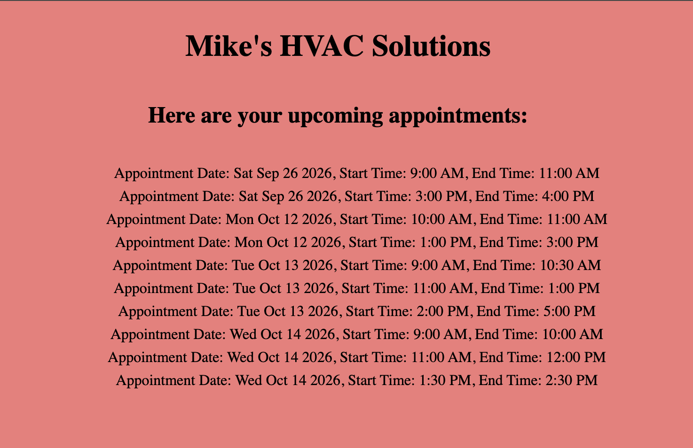

# Mike's HVAC Solutions — Appointment Checker

A front-end app that shows a trades business's upcoming appointments, pulled from the Google Calendar API.



## What it does

- Fetches events from a Google Calendar using the Google Calendar API (v3) and lists them on the page.
- Each appointment shows its date, start time, and end time.

## Tech stack

- HTML, CSS, vanilla JavaScript (ES modules)
- Google Calendar API — no server, no dependencies

## How to run it

There is no server to start, but the page must be served over HTTP, because `main.js` uses ES module imports — opening the file directly from disk will not load it. Serve the `appointment_app` folder with a static server, for example VS Code Live Server, then open the page it serves.

## Project structure

```
appointment_app/
  index.html         - "Mike's HVAC Solutions" — the appointment list
  js/main.js         - fetches calendar events and renders each appointment
  js/config.js       - Google API key and calendar ID
  css/style.css      - page styling
```

---

Thay Brown — thaybrown22@gmail.com · https://thaythecoder.netlify.app · https://github.com/tbrown320 · https://www.linkedin.com/in/thaybrown
